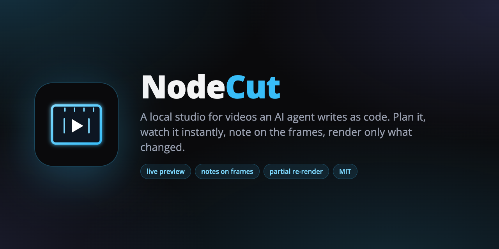
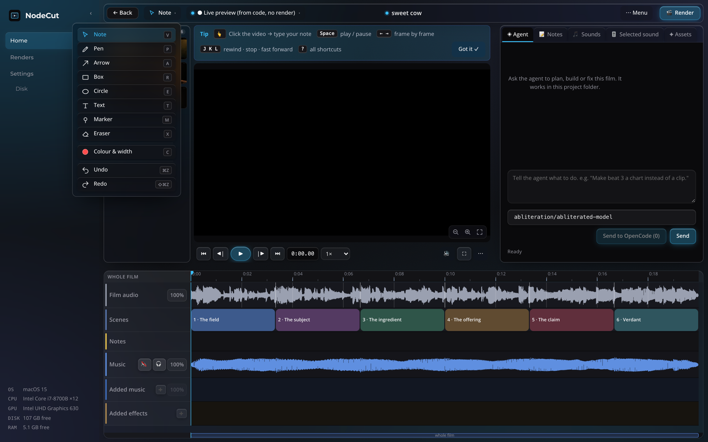
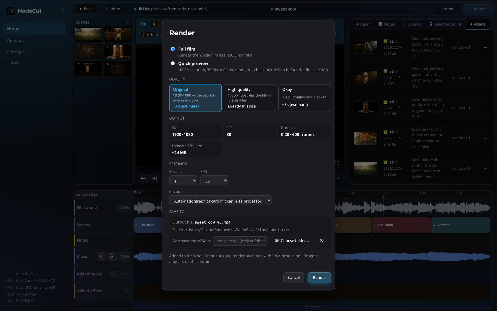
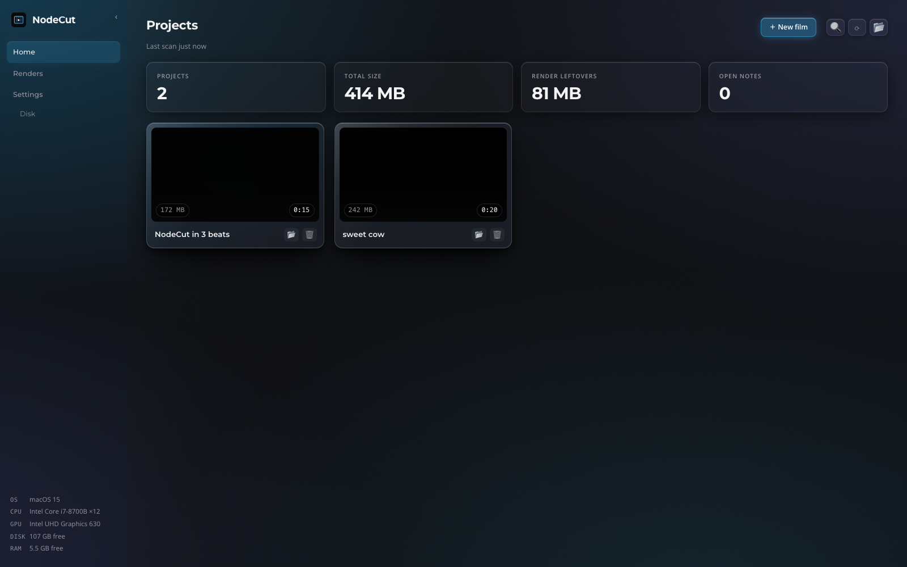
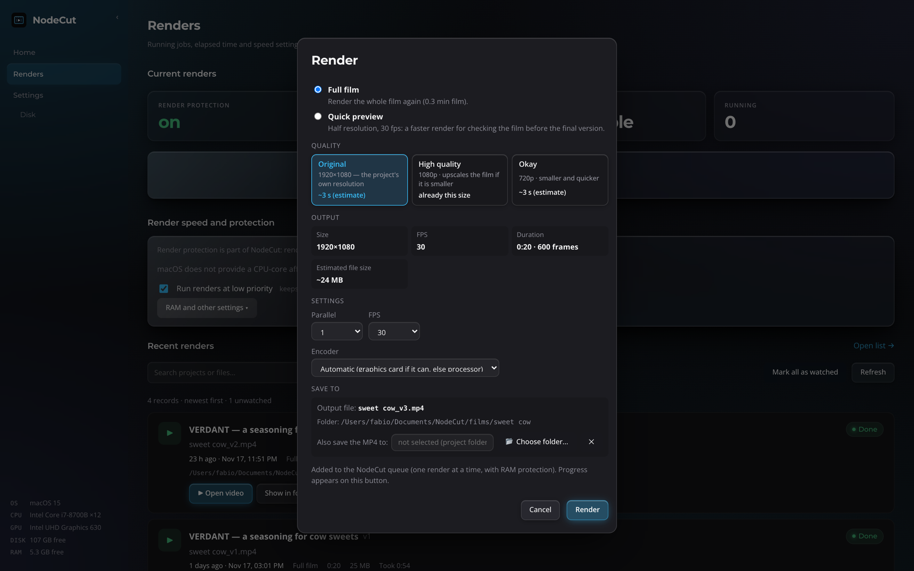
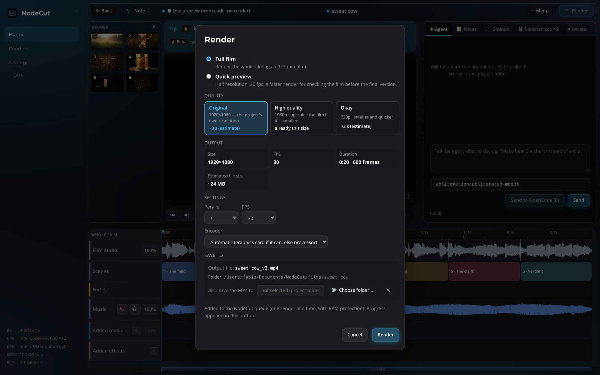

# NodeCut

**A local studio for videos that an AI agent writes as code — with craft notes that plan the film, a checker that
refuses the obvious, and an agent you can talk to without leaving it.**

Ask for a video. The agent writes it as a web page that draws every frame in code, so NodeCut can play any moment
instantly, frame-accurate, without rendering. Watch it, step through it, note what is wrong on the frames themselves,
and send those notes back. Then render, on a queue that keeps the computer usable and re-renders only the seconds that
changed.

Built for people who want a **film**, not a slideshow. It carries a craft reference, a taste contract and a refusal gate,
so the difference between "looks generated" and "looks designed" is enforced rather than hoped for.

> **NodeCut is its own repository, owned and maintained by Fabio (iamfabz).** It began as a fork of
> [VideoHub](https://github.com/iamfabz/Videohub), and **the VideoHub contributors keep full credit and copyright for the
> original work** (see [LICENSE](LICENSE)) — NodeCut would not exist without them. The plan checker's seven dimensions owe
> a debt to [OpenMontage](https://github.com/alfredfrancis/OpenMontage), and the craft notes to the public writing of
> Kurzgesagt, Mayer, 3Blue1Brown and Murch. **No OpenMontage code or text is in this tree**: it is AGPL-3.0, NodeCut is
> MIT, and the ideas were restated in NodeCut's own words. The full record of what changed since the fork is
> [docs/LOCAL-CHANGES.md](docs/LOCAL-CHANGES.md).

> **Windows 10/11, Linux and macOS; Claude Code or OpenCode.** See [platform support](docs/PLATFORMS.md) for feature
> limits and the remaining hardware checks.



_The review page: one row at the top (Back, tools, the version picker, the film's name), the scene outline beside the
picture, the agent on the right, and the timeline below with room to read it._

## What makes this different

Most AI video tools generate *content*. This one keeps the film as **code that is a pure function of `t`** — so any frame
can be drawn in any order, a preview is instant, and a re-render touches only what changed. Everything else is built on
that one guarantee.

| | |
|---|---|
| **A film is code** | `renderOut(t)` draws second `t`. No clock, no unseeded randomness, no state between frames. Seeking, frame stepping and chunked re-renders all agree. |
| **Craft notes route the plan** | Ten short notes on pacing, mediums, type, sound, camera and review. A brief picks the three or four that matter. |
| **A plan is checked** | Every beat names a **medium** and says **why it exists**. A plan that puts one medium on every beat is refused before a single frame is written. |
| **The agent lives here** | Talk to OpenCode inside the film's review page. It remembers the film across restarts and other projects. |
| **Quality on the way out** | Render at the project's own size, at 1080p (upscaling a smaller master with lanczos), or at a smaller 720p copy for a quick look — each with its own estimated time before you commit. |

## Features

**Plan**
- **A brief on every film** — the New film dialog asks what the film is *for*, not just what to call it. The brief is
  required, saved to the project, and read by the agent as the starting point.
- **A craft reference** — ten short notes in `docs/craft/` covering pacing, per-beat mediums, typography, sound, camera
  vocabulary, story structure and self-review. Your brief routes to the three or four that apply, so the agent reads a
  page instead of a library.
- **The slideshow gate** — a plan is scored on seven axes before it is built: repetition, decorative-only visuals, weak
  motion, weak shot intent, typography overreliance, unsupported cinematic claims, and **media variety** (three beats in
  a row on one medium is refused). Every problem it reports comes with the fix.
- **Per-beat mediums** — kinetic type, diagram, image-to-video, motion graphics, footage, chart. Choosing per beat is what
  stops a film looking like a template.

**Make**
- **Live preview, no render** — plays from the page itself, frame-accurate, with sound, scenes and narration on a
  timeline. Changing the code reloads the open preview in place.
- **Craft library** — one deterministic set of primitives (27 easing curves, keyframe tracks, beat pulses, transitions,
  scrim/vignette/grain/letterbox, kinetic type) so every film does not start from zero. A test forbids `Date.now`,
  `new Date` and `Math.random` in it.
- **Generated media** — a still or a clip from a model, baked into sprite atlases so the film can still seek inside it.
  Behind four gates: off by default, the price on screen before the submit, a daily cap, and a one-still tunnel that
  closes at submit.
- **◈ Agent tab** — talk to OpenCode in the film's own folder: one turn at a time, a model picker, and the CLI's errors
  shown in plain words. Answers are short and non-technical.

**Review**
- **Notes on frames** — click or draw on any frame (or pick a range) and say what is wrong. The agent gets the time,
  frame, chunk and a close-up of your drawing.
- **Scene outline** — a grid of real thumbnails beside the picture, so you can jump to a scene instead of scrubbing. Each
  shot is captured at the scene's midpoint, where the picture is not black.
- **Assets with previews** — every still and clip the models made, shown as itself: a still shows the image, a clip shows
  its first frame with a play badge.
- **Contact sheet** — one labelled grid of N frames in about a second, without a render. Catch a muddy shot, a wrong
  composition or a frozen stretch before you spend a minute encoding.
- **Check fixes** — a tour through what the agent marked fixed, with before and after. "Still there" sends it back.



**Deliver**
- **Render queue** — one render at a time, progress and ETA, size/fps/workers/encoder, a copy to any folder, a desktop
  notification when available.
- **Three output qualities** — original, 1080p high quality (upscales a smaller film), or 720p okay. Each card carries an
  estimate worked out from this film's last render, so the trade is visible before you press Render.
- **Partial re-render** — re-renders only the chunks your notes touched, joins the film again, and saves `film_vN.mp4`
  with the changed ranges. **Watch only the changes** plays just those.
- **Render protection** — CPU affinity, niceness and RAM slow mode, so the computer stays usable.
- **Recent renders & outputs** — every finished render, hard-linked into a dated folder with no extra disk.
- **Disk cleanup** — what can safely go and why, always to Trash or the archive, always with your approval.
- **Sound** — mute/solo/levels per stem, remove the music, duck it under a range, add sounds from your library or disk.
- **Thumbnail Studio** — sketch a thumbnail, send it to the agent, annotate the variants.
- **Agent tools (MCP)** — `hub_live`, `hub_plan`, `hub_notes`, `hub_note_update`, `hub_render`, `hub_job`,
  `hub_project`, `hub_workspace`, `hub_contact_sheet`, `hub_generate_plate`, `hub_generate_clip`, `hub_gen_import`,
  `hub_gen_list`, `hub_register_version`, `hub_cleanup`. The same
  tools work from a shell (`node server/cli.js`).



## How a film gets made

```
you write a brief        →  the craft notes that apply    →  the agent writes plan.json
in the New film dialog      and ~10 craft files           one medium + one reason per beat
                                                                   ↓
   the plan is scored  ── refused if it repeats  ──→  the agent writes film.js from it
                                                                   ↓
   live preview → your notes on frames → agent fixes → contact sheet → render
```

Each step leaves a file in the project, so the thinking survives the chat:

| file | what it holds |
|---|---|
| `BRIEF.md` | what the film is for, in your words |
| `plan.json` | the beats: medium, why, camera, payoff — scored before it is built |
| `AGENT.md` | the film's conversation with the agent, across restarts |
| `film.js` | the film itself, as code |

## The slideshow gate

The failure this studio exists to prevent: every beat is a clip with a caption on it. That reads as generated no matter
how good the render is.

A plan is scored from 0 (strong) to 5 (fail) across seven dimensions. **Media variety and repetition carry double
weight**, and the gate refuses on them regardless of the average — an average can be argued down by dimensions that do
not apply (no camera move, no text) while the film is still six identical shots.

A real example, same film, same brand, same 20 seconds:

| | before | after |
|---|---|---|
| risk | **1.9 · refused** | **0.3 · strong** |
| beats | six clips with a caption | footage · image-to-video · kinetic type · motion graphics · chart · diagram |

## Render protection and speed
Built into the Node server, with no compiled helper:
- **CPU limits and priority** — Windows uses processor affinity; Linux uses `taskset` when installed. Renders run at low
  priority. These systems offer Full power / Balanced / Quiet presets and a temporary full-power window.
- **macOS protection** — uses niceness and background QoS (`taskpolicy`) when a render slows down. macOS has no supported
  CPU-core affinity API, so NodeCut hides the Render power and slow CPU sliders and explains the limit. Priority and RAM
  protection remain available.
- **RAM slow mode** — when available RAM crosses a threshold, the newest render slows down; at critical RAM, every render
  slows down. macOS counts free, inactive and speculative memory through `vm_stat`.
- **Slow down / Normal speed / Stop** per render, or for all renders at once. NodeCut never requests elevated privileges.
- **One render at a time**, partial re-renders, workers / encoder / fps controls, and a list of other programs holding RAM
  (NodeCut never closes them).
- **Hardware encoders** — Windows: NVENC / AMF / QSV; Linux: NVENC / VAAPI / QSV; macOS: VideoToolbox; x264 is the
  processor fallback. See [render speed](docs/RENDER-SPEED.md).





## Requirements
All platforms need Node.js 22+, ffmpeg on PATH, a native Chrome/Chromium/Edge browser for headless rendering, and Claude
Code or OpenCode for making and fixing films. No native modules or compiled render-protection helper are required. The
◈ Agent tab needs the `opencode` command on PATH (the tab says so plainly if it is missing).

| Platform | Install missing tools | Notes |
|---|---|---|
| Windows 10/11 | `winget install -e --id OpenJS.NodeJS.LTS`; `winget install -e --id Gyan.FFmpeg` | Edge or Chrome; setup retains the existing Windows paths |
| Linux desktop | Your distribution's Node 22+ package; `sudo apt install ffmpeg`, `sudo dnf install ffmpeg`, or `sudo pacman -S ffmpeg` | Install a native browser; Snap/Flatpak browser wrappers are unsupported. Optional `taskset`, `zenity`/`kdialog`, `notify-send` |
| macOS | With Homebrew: `brew install node ffmpeg`; `brew install --cask google-chrome`, or Chrome from its download page | Chrome / Edge / Chromium in `/Applications` or `~/Applications` |

A graphical desktop session is needed for windows, folder dialogs, desktop notifications and file-manager actions. A
compatible graphics encoder is optional.

## Install
Download the ZIP and unpack it, or clone the repository into a folder you want to keep. Open that folder in Claude Code or
OpenCode and ask it to install NodeCut, or run the installer yourself. Setup asks about the workspace, discovered video
folders, graphics encoding, agents, review rule, shortcut, login startup and example film. Re-runs keep existing answers,
folders and settings.

### Windows
Double-click **SETUP.cmd**. It runs the shared Node installer directly. Preview the steps with
`node scripts/install.mjs setup --dry-run`; `--yes` accepts recommended answers. Examples: `--workspace "D:/Videos/NodeCut"`
and `--agents claude,opencode`.

The `.ps1` setup/update/uninstall files are compatibility forwarders and respect PowerShell's existing policy. If that
policy blocks one, use the Node command or `.cmd` entry point; no policy change is needed.

Open NodeCut from its Desktop shortcut or **open.cmd**. Start a new session in your selected agent to load `hub_*` tools.

### Linux and macOS
Run `chmod +x setup.sh update.sh uninstall.sh open.sh`, then `./setup.sh`. Preview first with
`./setup.sh --dry-run --agents opencode`. Setup prints missing-system-tool instructions instead of silently installing
system packages.

Flags: `--yes`, `--workspace PATH`, `--agents claude,opencode`, and `--watch-found`, `--gpu-encoder`, `--global-rule`,
`--shortcut`, `--startup`, `--example` with `yes` or `no`. Launch with `./open.sh`.

On macOS the optional Desktop launcher is **NodeCut.command**, which briefly opens Terminal. There is no unsigned `.app`
bundle. If macOS blocks it, go to **System Settings → Privacy & Security → Open Anyway**.

### Claude Code and OpenCode
Setup detects the installed agents. Each receives its own local MCP registration, the shared skill and the optional marked
review rule. Restart the selected agent after setup.

OpenCode's rules live in `~/.config/opencode/AGENTS.md` (under `$XDG_CONFIG_HOME` if set). Settings → Agent name controls
the review button label.

## Your first film
1. Click **＋ New film**. Give it a **name** and a **brief** — one or two sentences on what it is and who it is for.
   NodeCut creates the folder, saves the brief, picks the pipeline and opens the live preview.
2. The preview plays the starter. Press Space, step with ← →, click on the video to leave a note.
3. Ask your agent to build it. It calls `hub_plan` (which reads your brief), then writes `plan.json` and the film.
4. Press **🎬 Render** → *Full film*. The queue renders in two-second chunks and saves `film_v1.mp4` with sound.
5. Leave a note, fix it, then **🎬 Render** → *Only the fixed parts*: only the touched chunks render again →
   `film_v2.mp4`, and **Watch only the changes** plays them.

What a film folder must contain for each feature: [docs/PROJECT-CONTRACT.md](docs/PROJECT-CONTRACT.md). New films start
from [templates/new-film](templates/new-film).

## Working with your agent

You can work in your chat, or in the **◈ Agent tab** inside NodeCut — both act on the same film folder.

1. **Ask** for a video, or write the brief in the New film dialog.
2. **Plan** — `hub_plan` reads the brief, names the few craft notes to read, then scores the beat table.
   A plan that repeats one medium is refused.
3. **Preview** — `hub_live` opens the film in NodeCut and stops for your review.
4. **Notes** — watch, leave notes, press **Send to Claude / OpenCode** and paste the message, or ask in the Agent tab.
5. **Fix** — the agent reads `hub_notes`, edits the code, marks the fixes. The preview updates itself.
6. **Render** — when you ask. Later fixes can render only the changed chunks.

If MCP tools are not loaded, the same tools work through `node <NodeCut>/server/cli.js <tool> "<json>"`.

## Optional integrations
| Feature | Needs | Without it |
|---|---|---|
| Ready-made sound effects | a 3D studio engine with `engine/audio/synth.js` (`studioDir` in Settings) | your own sound folder and files from disk |
| Scene editor / 2D layers in the preview | the page includes the hooks from `engine-hooks/` | those editors are hidden |
| ◈ Agent tab | the `opencode` command on PATH | notes and renders still work; the tab explains what is missing |
| Generated stills and clips | a DeepInfra key (stills) and an OpenRouter key (clips) in Settings → Generation | you can still import media you already have |
| Snipp export status | Snipp writing `.renders\*.json` in a watched folder | not shown |
Settings → *Optional parts on this computer* shows what was found.

## Security
NodeCut is a local tool. The server listens on **127.0.0.1 only** and refuses requests with a foreign Host, cross-site
requests from other web pages and writes with a foreign Origin. Its render queue can run shell commands for your projects,
so **never expose the port** (no port forwarding, no tunnels, no `0.0.0.0` proxies). It only serves files inside your
watched folders, the archive and its own folders.

The ◈ Agent tab runs `opencode` on this machine with your own credentials, in the film's folder, with the same permissions
your terminal would have. It is off unless you use it, and it never receives your API keys.

### Windows launch and security warnings
Windows setup, update and uninstall use the shared Node lifecycle commands listed in the security guide. `SETUP.cmd` and
`UPDATE.cmd` call Node directly. Normal launch uses `open.cmd` → Node → `scripts/install.mjs open`; Desktop shortcuts and
login startup also use the installed Node executable. None of these paths changes PowerShell's execution policy.
[Windows security guidance](docs/WINDOWS-SECURITY.md) has the exact-alert evidence.

## Update
Run **UPDATE.cmd** (Windows) or `./update.sh`. Re-runs keep your answers and settings.

## Uninstall
Run **UNINSTALL.cmd** (Windows) or `./uninstall.sh`. Your films are never deleted.

## Troubleshooting
- **The page says the server is off** — NodeCut closes itself when unused for a couple of minutes. Open it again from the
  shortcut; the window reconnects on its own.
- **A hub tool fails** — the hub usually starts itself. If not, run `node server/hub.js` in the NodeCut folder.
- **The Agent tab says the agent stopped** — the CLI's own reason is shown in the tab. A blocked model or a spent credit
  are the two common ones; the model picker in the tab lets you switch.
- **A render is slow** — see [render speed](docs/RENDER-SPEED.md) and the Render power presets.

## Development
`npm test` runs every suite (384 tests: 382 pass, 1 skipped, 1 known upstream failure). `npm start` runs the hub. The
architecture is in [docs/ARCHITECTURE.md](docs/ARCHITECTURE.md); every change this fork made is in
[docs/LOCAL-CHANGES.md](docs/LOCAL-CHANGES.md).

## Credits
NodeCut is a fork of **[VideoHub](https://github.com/iamfabz/Videohub)**. The VideoHub authors wrote the foundation this
studio is built on — the pure-function-of-`t` film model, the review loop and the render queue — and they keep the
copyright to it. Thank you. See [LICENSE](LICENSE).

The plan checker was informed by **[OpenMontage](https://github.com/alfredfrancis/OpenMontage)**, which is AGPL-3.0.
Nothing from it is copied here: its ideas are restated in NodeCut's own words, which is why this repository can stay MIT.
See [docs/LOCAL-CHANGES.md](docs/LOCAL-CHANGES.md).

## License
MIT. NodeCut began as a fork of VideoHub; the upstream authors keep their copyright, see [LICENSE](LICENSE).
